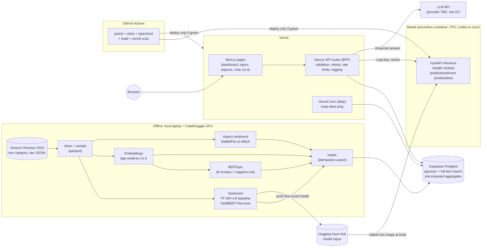
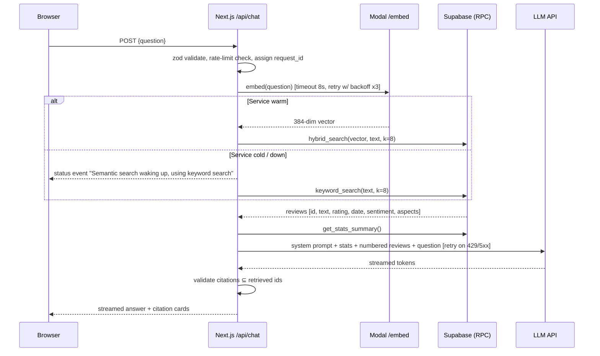

# PLAN.md — Customer Review Intelligence Tool

> Status: **APPROVED 2026-10-11** (Phase 1). Decisions resolved in §7.
> Last updated: 2026-10-11

---

## 0. TL;DR

- **Precompute everything you can; keep live paths small.** The dashboard (sentiment trends, topics, aspects) reads **only precomputed tables in Postgres**. It never waits on a model, so a cold inference container can't break it.
- **The inference service (FastAPI on Modal) handles only what has to be live:** embedding the user's chat question, plus a "Try it" page that scores a pasted review.
- **The browser talks to exactly one backend: Next.js API routes on Vercel.** Those routes hold every secret and call Supabase, the inference service and the LLM. This one decision removes most CORS and secret-leak problems.
- **Chat degrades gracefully.** If the inference service is cold, retrieval falls back to Postgres keyword search, and the UI says so, so chat doesn't just fail.

Your proposed split is right in shape. Section 1.2 lists what I changed and why.

---

## 1. Architecture

### 1.1 System diagram



### 1.2 What I changed from your proposed split, and why

| # | Change | Why |
|---|--------|-----|
| 1 | **The dashboard never calls the inference service.** Every chart reads precomputed tables. | A scale-to-zero container needs ~10–30 s to cold-start. The 90% of the app that is analytics shouldn't depend on that. Reading precomputed data is also how real BI tools work: you don't re-run a model on every page view. |
| 2 | **The inference service's job is narrowed to `/embed`, `/predict/sentiment`, `/predict/absa` and `/health`.** | Less to load means faster cold starts and lower RAM. The models are **baked into the Docker image at build time**, so a cold start loads from local disk instead of re-downloading about 1 GB from the Hub. |
| 3 | **Next.js API routes act as a Backend-for-Frontend (BFF).** The browser never calls Supabase, the inference service or the LLM directly. | Secrets stay on the server. CORS mostly goes away because the browser only calls its own origin. Validation, rate limiting and logging all live in one place. |
| 4 | **One embedding model (`BAAI/bge-small-en-v1.5`, 384-dim) is used for both BERTopic and RAG.** | We compute embeddings once and use them twice. A small 384-dim model keeps the database under its free 500 MB limit (see §6) and runs fast on CPU in the inference service. |
| 5 | **Retrieval is hybrid (pgvector + Postgres full-text search, merged with Reciprocal Rank Fusion), and keyword-only search is the fallback.** | Hybrid search usually beats either method alone on product reviews, which are full of exact terms like model names. It also gives chat a path that works when the inference service is asleep. |
| 6 | **Chat answers are grounded in reviews *and* a small precomputed stats summary.** | RAG over 8 retrieved reviews can't answer "what % of reviews were negative in 2023?". Adding a compact stats block, built from our aggregate tables, lets the LLM answer quantitative questions truthfully. |
| 7 | **Citations are validated on the server.** The LLM may cite only the IDs of reviews we actually retrieved, and anything else is stripped and logged. | This is a cheap, deterministic guard against fabricated citations. |
| 8 | **ABSA = curated aspect lexicon + pretrained DeBERTa ABSA model.** The LLM-JSON approach is used only as an optional comparison on a small eval set. | `yangheng/deberta-v3-base-absa-v1.1` classifies a *(sentence, aspect)* pair but doesn't discover aspects. So we need an aspect list first, seeded from BERTopic keywords and curated by hand. Running an LLM over 100k+ reviews would also cost money and run into rate limits. |
| 9 | **The database is split into an "analysis set" and a "serving corpus".** We analyze about 150k reviews offline. Postgres stores all the aggregates, but only a stratified **~50k-review corpus** with text and embeddings. | Storage math (§6) shows that 150k reviews with text, a vector index and a full-text index would exceed the 500 MB free tier. |
| 10 | **A daily Vercel Cron keep-alive pings Supabase. The chat and Try-it pages send a warm-up ping to the inference service when they open.** | Free Supabase projects pause after about 7 days of inactivity. Modal bills only while containers run, so a daily ping would only buy one warm minute; warming on page open hides most of the cold start instead. |
| 11 | **Deploys run from GitHub Actions *after* tests pass.** We don't use Vercel/HF auto-deploy-on-push. | This implements your rule that "tests run before each deploy", so a red build can't ship. |
| 12 | **A request ID is propagated from Next.js to the inference service and appears in every log line on both sides.** | When something fails, you can follow one user request across two services. That's the core of the Phase 3 self-diagnosis goal. |

### 1.3 Why each component (the short "why")

- **Python offline pipeline, not in production:** training and topic modeling are batch jobs. Running them once and storing the results is cheaper, faster and reproducible.
- **Colab/Kaggle for GPU:** fine-tuning DistilBERT on about 100k reviews takes hours on CPU and under an hour on a T4. Kaggle is the backup because its GPU quota is weekly and predictable.
- **HF Hub for models:** it's free, versioned, git-based storage that the inference service can pull from at build time, and it doubles as a portfolio artifact with a model card.
- **FastAPI on Modal (amended 2026-10-12):** HF made Docker/Gradio Spaces PRO-only for new free accounts, so the same container code now runs on Modal (serverless, $30/month free credits, scales to zero). A container gives us full control over the runtime (pinned torch CPU wheels, a non-root user, a baked-in model cache). FastAPI gives us Pydantic validation and OpenAPI docs for free.
- **Supabase Postgres + pgvector:** one database handles relational analytics, vector search *and* full-text search. One service means one set of credentials and one thing that can be down.
- **Next.js on Vercel:** this is the deployment target you chose. The App Router gives us server components for fast dashboard pages and route handlers for the BFF.

### 1.4 Chat request sequence (the most complex live path)



---

## 2. Monorepo folder structure

```
review-intel/
├── README.md                  # setup, results table, screenshots, limitations
├── PLAN.md                    # this file
├── RISKS.md                   # Phase 2
├── ERROR_LOG.md               # incident log (Phase 3 workflow)
├── .gitignore                 # data/, models/, .env*, node_modules, .venv, caches
├── .env.example               # every env var, no values
├── .github/workflows/
│   ├── ci.yml                 # lint, typecheck, pytest, vitest, next build, gitleaks
│   ├── deploy-inference.yml   # on main + green CI → modal deploy inference/modal_app.py
│   └── deploy-web.yml         # on main + green CI → vercel deploy --prod
│
├── data/                      # GITIGNORED
│   ├── raw/                   # downloaded JSONL.gz
│   ├── interim/               # cleaned parquet
│   └── processed/             # predictions, topics, aspects, embeddings (.parquet/.npy)
│
├── pipeline/                  # offline Python (uv project)
│   ├── pyproject.toml
│   ├── uv.lock
│   ├── src/review_intel/
│   │   ├── config.py          # paths, seeds, sample sizes, category name
│   │   ├── logging.py         # JSON logger shared by scripts
│   │   ├── data/              # download.py, clean.py, sample.py, schema.py (pandera)
│   │   ├── sentiment/         # labels.py, baseline.py, evaluate.py
│   │   ├── embeddings/        # embed.py
│   │   ├── topics/            # run_bertopic.py, label_topics.py
│   │   ├── absa/              # lexicon.py, aspects.yaml, run_absa.py
│   │   ├── aggregate/         # build_aggregates.py (monthly sentiment, aspect summary, stats)
│   │   └── load/              # to_supabase.py (idempotent upserts)
│   ├── notebooks/
│   │   ├── 01_eda.ipynb
│   │   ├── 02_baseline_tfidf_lr.ipynb
│   │   ├── 03_distilbert_finetune_colab.ipynb   # runs on Colab/Kaggle
│   │   ├── 04_topics_bertopic.ipynb
│   │   ├── 05_absa.ipynb
│   │   └── 06_rag_eval.ipynb
│   ├── reports/               # committed: metrics/*.json, figures/*.png, data_card.md
│   └── tests/                 # pytest: cleaning, labels, schema, aggregates, loader
│
├── inference/                 # FastAPI service → deployed to Modal (modal_app.py); Dockerfile kept for portability
│   ├── Dockerfile             # python slim, CPU torch, non-root, models baked in
│   ├── modal_app.py           # Modal image (uv_sync from uv.lock) + asgi_app entrypoint
│   ├── pyproject.toml / uv.lock
│   ├── scripts/download_models.py   # run at docker build time
│   ├── app/
│   │   ├── main.py            # FastAPI app, routes, middleware
│   │   ├── models.py          # lazy singleton loaders
│   │   ├── schemas.py         # Pydantic request/response models
│   │   ├── security.py        # x-api-key check
│   │   ├── settings.py        # pydantic-settings from env
│   │   └── logging.py         # JSON logs with request_id
│   └── tests/                 # pytest with tiny stub models, so CI stays fast
│
├── web/                       # Next.js app → Vercel (root directory = web/)
│   ├── package.json / pnpm-lock.yaml
│   ├── next.config.ts
│   ├── vercel.json            # cron config, function maxDuration
│   ├── src/app/
│   │   ├── page.tsx           # Overview: KPIs + sentiment over time
│   │   ├── topics/page.tsx    # all topics + "top complaints"
│   │   ├── aspects/page.tsx   # aspect sentiment + drill-down
│   │   ├── chat/page.tsx      # RAG chat
│   │   ├── try/page.tsx       # paste a review → live sentiment + ABSA
│   │   ├── about/page.tsx     # model card, metrics, limitations
│   │   └── api/
│   │       ├── health/route.ts          # aggregated health (self, db, inference, llm)
│   │       ├── analytics/[...]/route.ts # read-only aggregates
│   │       ├── reviews/route.ts         # paginated drill-down
│   │       ├── chat/route.ts            # RAG (streaming)
│   │       ├── predict/route.ts         # proxies the inference service for "Try it"
│   │       └── cron/keepalive/route.ts  # CRON_SECRET-protected
│   ├── src/lib/
│   │   ├── env.ts             # zod-validated env, fails fast at boot
│   │   ├── db.ts              # server-only Supabase client
│   │   ├── inference.ts       # inference client: timeout, retry, cold-start detection
│   │   ├── llm.ts             # provider-agnostic LLM wrapper
│   │   ├── rag.ts             # retrieval, prompt building, citation validation
│   │   ├── retry.ts           # exponential backoff with jitter
│   │   ├── rate-limit.ts      # Postgres-backed limiter
│   │   ├── logger.ts          # JSON logger with request_id
│   │   └── validation.ts      # shared zod schemas
│   ├── src/components/        # charts, StatusBadge, ChatPanel, ReviewCard…
│   └── tests/                 # vitest: API routes with mocked deps
│
├── db/
│   ├── migrations/            # 001_schema.sql, 002_indexes.sql, 003_functions.sql, 004_rls.sql
│   └── README.md              # how to apply migrations
│
└── docs/
    ├── screenshots/
    └── architecture.md        # deeper notes if PLAN.md grows too long
```

**Why a single repo with three independent projects, and no Turborepo/Nx:** the Python and Node parts don't share code. A build orchestrator would add a lot of tooling for no benefit. Each folder has its own lockfile and its own CI job.

---

## 3. Tech stack and versions

> **How versions get pinned:** the table lists the target major/minor lines. In M0 I resolve the exact latest stable versions and commit them to `uv.lock` and `pnpm-lock.yaml`. Lockfiles, not this table, are the source of truth. That's how we avoid "works on my machine" dependency drift.

| Layer | Tool | Target version | Notes |
|-------|------|----------------|-------|
| Python runtime | CPython | **3.12** | Matches current Colab; well supported by torch and transformers |
| Python env/deps | uv | latest | Fast resolver with a lockfile. **Not installed yet** |
| Data | pandas, pyarrow | 2.2+, 17+ | Parquet everywhere; Polars is optional if memory gets tight |
| Validation | pandera | 0.20+ | Schema checks on dataframes, tested in CI |
| Classic ML | scikit-learn | 1.5+ | TF-IDF + LogisticRegression(class_weight="balanced") |
| Deep learning | torch | 2.4+ (CPU wheel in Modal image) | The CUDA build is only needed on Colab |
| Transformers | transformers, datasets, accelerate, evaluate | latest stable 4.x/5.x pinned in M0 | DistilBERT fine-tune, ABSA inference |
| Embeddings | sentence-transformers | latest stable | Model: `BAAI/bge-small-en-v1.5` (384-d, ~130 MB) |
| Topics | bertopic, umap-learn, hdbscan | 0.16+ | Uses precomputed embeddings |
| ABSA | `yangheng/deberta-v3-base-absa-v1.1` | — | ~700 MB; fine on CPU for single reviews |
| Notebooks | jupyterlab, matplotlib, seaborn | latest | |
| Inference API | FastAPI, uvicorn, pydantic v2, pydantic-settings | 0.115+, 0.30+, 2.x | |
| Python tests | pytest, httpx | 8.x | `TestClient` for FastAPI |
| Lint/format (Py) | ruff | latest | |
| Database | Supabase Postgres + pgvector | PG 15+/17, pgvector **≥ 0.7** | 0.7+ is required for `halfvec`, which halves vector storage |
| Node runtime | Node.js | **22 LTS** (whatever Vercel's default LTS is at M0) | You have Node 24 locally; I'll align `engines` with Vercel |
| Package manager | pnpm | 9+/10 | **Not installed yet** (`corepack enable` gives it with no separate install) |
| Frontend | Next.js (App Router), React, TypeScript | latest stable (15.x/16.x), 19, 5.x | |
| Styling/UI | Tailwind CSS, shadcn/ui | 4.x | Copy-in components with no heavy UI dependency |
| Charts | Recharts | 2.x/3.x | |
| Validation (TS) | zod | 3.x/4.x | Validates every API route and the env |
| LLM SDK | Vercel AI SDK (`ai`) + provider package | latest | One interface, so switching providers is a config change. Handles streaming |
| DB client | @supabase/supabase-js | 2.x | Server-side only |
| TS tests | vitest | 3.x | Route handlers tested with mocked fetch/db |
| Secret scanning | gitleaks | latest (GH Action) | Runs on every push |

---

## 4. Milestones with a definition of done

Each milestone ends with: a summary, run/verify commands, a README update and small commits, and then **a stop for your go-ahead**.

### M0 — Foundations and tooling
- Install the prerequisites, **with your approval first**: Python 3.12, uv, pnpm (via corepack), and optionally the GitHub CLI.
- Run `git init`, then add `.gitignore`, `.env.example`, `README.md` skeleton, `ERROR_LOG.md`, and a gitleaks pre-commit hook plus CI step.
- Scaffold `pipeline/`, `inference/` and `web/` with one trivial test each, plus `ci.yml`.
- Create the accounts and projects (free tiers only): GitHub repo, Supabase project, HF account and token, Vercel project, LLM API key.
- Check the free-tier limits in §6 against the live pricing pages and record any differences.
- **DoD:** `uv run pytest` (pipeline and inference) and `pnpm test && pnpm build` (web) pass locally and in GitHub Actions. gitleaks passes. A fresh clone plus the README instructions reproduces this.

### M1 — Data acquisition, cleaning, labeling
- Download one Amazon Reviews 2023 category, stream-parse it (never loading the full file into RAM), and draw a **time-stratified sample of ~150k reviews**.
- Cleaning: drop empty and very short reviews, strip HTML, normalize whitespace, deduplicate exact and near-exact texts, apply a light English filter, and parse timestamps.
- Labels from stars: 1–2 → negative, 3 → neutral, 4–5 → positive.
- Create a **fixed, stratified 80/10/10 train/val/test split** with a saved seed. Split by *product/parent_asin group* so the same product's reviews don't leak across splits.
- **DoD:** `data/interim/reviews.parquet` passes the pandera schema test. `reports/data_card.md` records source, licence, counts at each cleaning step and class distribution. Pytest covers the cleaning functions on hand-made edge cases.

### M2 — EDA notebook
- Rating and label distribution (imbalance), review length, reviews over time, top n-grams per class, and sanity checks (e.g. 5-star reviews containing "terrible").
- **DoD:** `01_eda.ipynb` runs top to bottom in a clean kernel. The figures are saved to `reports/figures/`. There's a written "Key findings" section of 5–8 bullets that feeds modeling decisions.

### M3 — Baseline: TF-IDF + Logistic Regression
- Word and character n-gram TF-IDF, `class_weight="balanced"`, and a small grid search on val macro F1.
- **DoD:** test-set **macro F1**, per-class precision/recall/F1 and confusion matrix are saved to `reports/metrics/baseline.json` and a PNG. The model is saved. README results table v1.

### M4 — DistilBERT fine-tune (Colab/Kaggle GPU)
- `distilbert-base-uncased`, max_len 256, **class-weighted cross-entropy** (compared against plain cross-entropy), early stopping on val macro F1, fp16, checkpoints saved to Drive.
- Error analysis: 30 misclassified examples, read and categorized (sarcasm, mixed sentiment, rating/text mismatch).
- Optional: a time-based split check, training on older reviews and testing on newer ones, to see drift.
- **DoD:** the model is pushed to the HF Hub with a model card. `reports/metrics/distilbert.json` has a comparison table vs. the baseline with the **same test set**, and the confusion matrices sit side by side. The notebook reruns end-to-end on Colab.

### M5 — Embeddings and BERTopic
- Embed all ~150k reviews with bge-small (GPU) and save them to `.npy`.
- Run BERTopic twice: (a) all reviews, (b) **negative reviews only** for "Top complaints". Reduce outliers, label topics with c-TF-IDF keywords and human-readable names (manual, optionally LLM-assisted for ~30 topics).
- **DoD:** topic tables (id, label, keywords, size, representative review ids, monthly counts) are saved. The intertopic map and bar charts are saved. I give a short qualitative assessment of which topics are coherent and which are junk.

### M6 — Aspect-based sentiment
- Build `aspects.yaml`: about 10–15 aspects with synonyms (e.g. battery: battery, charge, charging, battery life), seeded from M5 keywords and curated by hand.
- Split reviews into sentences, find aspect mentions, and run DeBERTa ABSA on each (sentence, aspect) pair on GPU.
- **Validation:** I hand-label ~200 pairs (you can help) and report accuracy and macro F1. Optionally, I compare the LLM-JSON approach on the same 200.
- **DoD:** an `aspect_mentions` parquet, an aspect summary (counts, % positive/negative, monthly trend), and the validation metrics recorded in the README.

### M7 — Database: schema, load, search functions
- Migrations for the tables `reviews` (serving corpus, ~50k, with `halfvec(384)` and a `tsvector`), `aspect_mentions`, `topics`, `topic_reviews`, `sentiment_monthly`, `aspect_monthly`, `stats_summary`, `model_metrics` and `rate_limits`.
- Indexes: HNSW on the vector, GIN on the tsvector, B-tree on dates.
- RPC functions: `hybrid_search`, `keyword_search`, `get_stats_summary` and `check_rate_limit`.
- **RLS enabled on every table with no public policies.** Only the server role can read, so a leaked anon key exposes nothing.
- An idempotent loader: rerunning it gives the same row counts.
- **DoD:** migrations apply on a fresh project. Loader row counts match the parquet files. **DB size is ≤ 350 MB** (checked with `pg_database_size`). Five sample queries return sensible reviews through `hybrid_search`. The loader has pytest coverage against a local Postgres or mocks.

### M8 — Inference service (FastAPI, built locally)
- Endpoints: `GET /health` (models loaded? version, uptime), `POST /embed`, `POST /predict/sentiment` and `POST /predict/absa`.
- Pydantic validation: max text length, max batch size. An `x-api-key` check on everything except `/health`. JSON logs with the request id.
- Dockerfile: CPU-only torch, models downloaded **at build time**, non-root user, port 7860.
- **DoD:** pytest passes with stub models. `docker build && docker run` locally passes a curl smoke test. I measure and report image size, cold-start load time and p50 latency per endpoint.

### M9 — Next.js dashboard (read-only analytics)
- Pages: Overview (KPIs, sentiment over time from both stars and model), Topics (all vs. top complaints), Aspects (bar chart, trend, drill-down to example reviews) and About (metrics, model card, limitations).
- `src/lib/env.ts` validates the env at boot. Every API route validates input with zod and returns typed errors.
- A `StatusBadge` component polls `/api/health` and shows: All systems OK / Model waking up / Degraded / Down.
- **DoD:** `pnpm test` (route tests with a mocked DB), `pnpm build` and lint/typecheck are green. Pages render from the real Supabase locally. Every chart has loading, empty and error states.

### M10 — RAG chat and "Try it"
- `/api/chat`: validate → rate limit → embed with retry/backoff → hybrid search, with keyword fallback → stats block → LLM streaming → citation validation. Global daily cap on LLM calls.
- `/try`: paste a review → `/api/predict` → inference service, with clear "waking up, retrying…" states.
- **RAG eval:** 20 hand-written questions, including 5 that the reviews *can't* answer. We check citation validity (100% required), answer faithfulness (manual 1–3 score), and that the model **declines** the unanswerable ones.
- **DoD:** the eval results are in `reports/rag_eval.md`. Route tests cover the fallback paths (inference down, LLM 429, invalid citations, oversized input).

### M11 — Hardening and docs
- Load-test sanity (a small burst against local), review of error messages, accessibility pass, README results table and limitations, screenshot placeholders filled.
- **DoD:** a full CI run is green. README sections are complete. ERROR_LOG is up to date.

### M12 — Deploy (Phase 5)
- `deploy-inference.yml` and `deploy-web.yml` are gated on CI. Secrets are set in the Modal secret store and Vercel. The cron is enabled.
- **DoD:** both live `/health` endpoints return OK. `scripts/smoke_test.sh <web-url> <inference-url>` passes (health, analytics, predict, chat with a citation, invalid-input rejection). The deployment checklist is in the README.

---

## 5. Data flow: raw dataset → what the user sees

| Step | Where | Input → Output | What the user eventually sees |
|------|-------|----------------|-------------------------------|
| 1. Download | laptop | HF dataset files → `data/raw/*.jsonl.gz` | — |
| 2. Clean + sample + label + split | laptop | raw → `interim/reviews.parquet` (~150k rows: id, product, rating, title, text, timestamp, label, split) | — |
| 3. Baseline train/eval | laptop | parquet → metrics JSON, confusion PNG | About page: results table |
| 4. DistilBERT fine-tune | Colab/Kaggle | parquet → model on HF Hub + metrics | About page; "Try it" predictions |
| 5. Batch predict | Colab | model + parquet → `sentiment_label`, `sentiment_score` per review | Overview: model-predicted sentiment trend |
| 6. Embed | Colab | text → 150k × 384 float vectors (`.npy`) | (feeds 7 and 9) |
| 7. Topics | Colab/laptop | embeddings + text → topics, review→topic map, monthly counts | Topics page, "Top complaints" |
| 8. ABSA | Colab | sentences × aspect lexicon → aspect_mentions (aspect, polarity, confidence) | Aspects page + drill-down |
| 9. Aggregate | laptop | all of the above → monthly sentiment, aspect summary, stats summary | Overview KPIs and charts |
| 10. Select serving corpus | laptop | 150k → ~50k stratified by month × label × topic (+ every topic's representative reviews) | Chat citations, drill-down reviews |
| 11. Load | laptop → Supabase | parquet → Postgres tables (vectors as `halfvec`) | Everything in the dashboard |
| 12. Serve analytics | Vercel → Supabase | page request → SQL on aggregates | Charts in < 1 s, no model needed |
| 13. Serve chat | Vercel → Modal → Supabase → LLM | question → embedding → top-8 reviews + stats → cited answer | Chat answer with clickable review cards |
| 14. Serve "Try it" | Vercel → Modal | pasted text → sentiment + aspect polarities | Live prediction |

**One important honesty point for the README:** sentiment labels come from star ratings, so "model sentiment over time" on *already-rated* reviews mostly agrees with the stars. We show both, and the gap between them is itself interesting (e.g. 4-star reviews with negative text). The classifier earns its keep on **text without stars**: the Try-it page and any future unrated data.

---

## 6. Free-tier limits and how we stay within them

> These numbers are from my knowledge as of mid-2026. **Free tiers change often, so verifying them against the live pricing pages is an M0 task.** The design leaves headroom so a modest cut won't break us.

| Service | Relevant free-tier limits (approx.) | Our expected usage | How we stay within |
|---------|-------------------------------------|--------------------|--------------------|
| **Supabase (Free)** | 500 MB database; ~5 GB egress/month; 2 active projects; **pauses after ~7 days without activity** | Target **≤ 350 MB** (see math below) | Serving corpus capped at ~50k; `halfvec(384)`; text truncated to 2,000 chars; daily keep-alive cron; a DB-size check in the loader that fails loudly above 400 MB |
| **Modal (Starter, amended 2026-10-12)** | **$30/month free compute credits**; CPU ≈ $0.0000131/core-s, memory ≈ $0.00000222/GiB-s; scales to zero; cold start ~10–30 s (+ model load) | 1 core + 2–3 GiB, only while serving. ~5 container-hours/month at portfolio traffic ≈ **under $1 of the $30** | `scaledown_window=300`, `min_containers=0`; models baked into the image; ABSA lazy-loaded; warm-up ping on page open; retry + "waking up" UI; dashboard independent of the inference service. A spend alert in the Modal dashboard |
| **Hugging Face Hub** | Free public model and dataset repos | 1 model repo (~260 MB) | Public repo with a model card. We **don't re-upload the Amazon dataset** (licence), only the model |
| **Vercel (Hobby)** | **Non-commercial use only**; ~100 GB transfer/month; capped function invocations and CPU-hours; 250 MB function bundle; function timeout limits (verify current max); cron jobs at **daily frequency at most** | Low (portfolio traffic) | No ML libraries in functions (bundle stays small); routes aim for < 10 s, chat streams; server-component data cached with revalidation; exactly 1 daily cron |
| **Google Colab (Free)** | T4 GPU when available; sessions up to ~12 h, idle disconnects ~90 min; **usage not guaranteed** | DistilBERT: ~45–90 min. Embeddings: ~10 min. ABSA: ~20–40 min | Checkpoint to Google Drive every epoch; resumable scripts; **Kaggle (≈30 GPU-h/week) as fallback** |
| **GitHub Actions** | Unlimited minutes for **public** repos (2,000 min/month for private) | ~3–5 min per CI run | Public portfolio repo; dependency caching; CI tests use stub models (no torch download) |
| **LLM API** | Depends on provider (see §7). Free tiers have requests/min and requests/day caps | ~2–3k input + ~400 output tokens per chat turn | Our own caps set *below* provider limits: per-IP rate limit (e.g. 10/hour) + global daily cap (e.g. 300/day) in Postgres; retry with backoff on 429; friendly "daily demo limit reached" message |

**Storage math (why we keep 50k reviews in the DB rather than 150k).** Estimated per review:

| Item | Bytes |
|------|-------|
| Text, truncated (avg) | ~600 |
| tsvector column + GIN index | ~800 |
| `halfvec(384)` (2 bytes × 384) | ~770 |
| HNSW index (roughly the size of the vectors) | ~1,000 |
| Metadata + row overhead | ~300 |
| **Total** | **≈ 3.5 KB** |

That works out to **≈ 175 MB for 50k** reviews vs. **≈ 525 MB for 150k**. Aggregates for the full 150k are tiny (a few MB), so the dashboard still reflects every review. Only chat and drill-down see the 50k sample. We'll state that in the UI.

---

## 7. Decisions (resolved 2026-10-11)

The plan was approved without overrides, so the recommended defaults apply. Any of them can still be changed before the milestone that depends on it.

| # | Decision | Choice | Locked by |
|---|----------|--------|-----------|
| 1 | Dataset/category | **Amazon Reviews 2023, `Cell_Phones_and_Accessories`** | M1 |
| 2 | LLM provider | **Google Gemini Flash free tier** behind the Vercel AI SDK. Claude Haiku 4.5 is an optional paid A/B later, and only if you approve it | M10 |
| 3 | Repo location | **Move to `C:\dev\review-intel`** (out of OneDrive) as the first step of M0 | M0 |
| 4 | Early walking-skeleton deploy | **Yes**: hello-world inference service (Modal) and Vercel page in M0 | M0 |
| 5 | GitHub repo visibility | **Public** | M0 |
| 6 | Sample sizes | **~150k analysis set / ~50k serving corpus**, configurable in `config.py`. Development iterates on a 20k subset first | M1 |
| 7 | Inference host *(amended 2026-10-12)* | **Modal** (Starter, $30/month free credits) instead of an HF Docker Space. HF now requires PRO for Gradio/Docker Spaces on new free accounts. The HF **Hub** is still used for model storage | M0 |

---

## 8. What happens next

Phase 1 is approved → **Phase 2: RISKS.md**, then a stop for your review. No code, installs or accounts until then.
